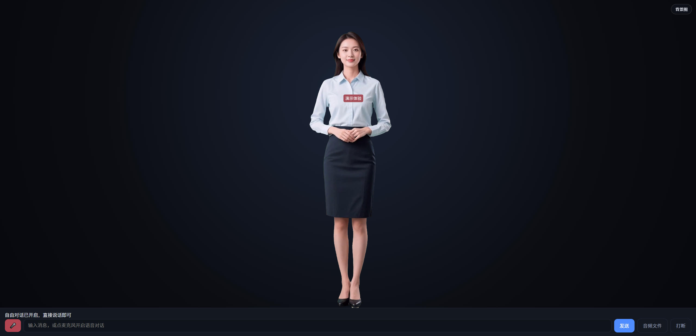
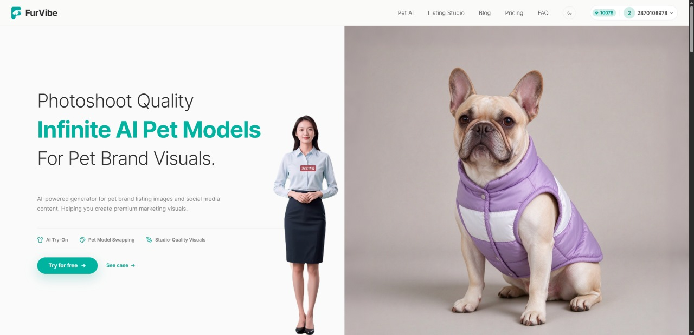
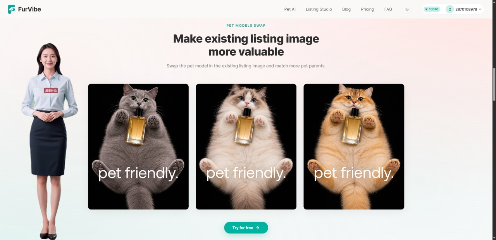

# LiveAvatar Web

# 让您的网页服务轻松接入实时互动数字人
基于C++引擎开发，游览器webgpu或WASM模式推理，模型跑在客户端上，服务器与客户端都不需要显卡，随便一块cpu就可以。PC端现代浏览器运行流畅，口型良好

## 👌 零显卡-响应快-高并发-低成本
## 🎉 用于Ai客服、Ai培训、Ai教师、虚拟面试、微课制作、Ai员工、追忆亲人

## Update Log

2026-11-26: 新增 iframe 嵌入方式，其他网站可以直接挂一个透明数字人（见下文「嵌入其他网站」）
2026-11-23: demo上线了透明背景功能，右上角可提交新背景图，demo：https://liveavatar.daihuajun.cn


## 效果预览

<p align="center">
  
  
  
</p>


## 目录

```
client/          前端：WebGPU 推理 worker + 音频时钟渲染 + WebGL 抠像合成
server/          后端：Flask，只做 ASR / 对话 / TTS（app.py, chat.py, asr.py, key.py）
models/          live_hubert.onnx、<形象>.onnx（视觉模型与数字人同名）
assets/<形象>/   loop.mp4、mask.mp4、faces/*.webp、meta.json
tools/           matte_loop.py（离线抠像）、prepare_assets.py、export_onnx.py
```


## 运行

```
pip install -r requirements.txt
python server/app.py            
访问：http://127.0.0.1:7861/

```

当前后端接入了coze agent，百炼asr(qwenqwen-audio-3.1-asr-flash)，百炼tts(qwen-audio-3.1-tts-flash)，需要自行开通key。您也可以自行二次开发接入其他agent和语音模型
凭据在 `server/key.py` 或环境变量读（`COZE_TOKEN`、`COZE_BOT_ID`、`ALIYUN_TTS_API_KEY`、`ALIYUN_TTS_VOICE`）。

demo：https://liveavatar.daihuajun.cn

调试后端：`?ep=webgpu` 强制 WebGPU、`?ep=wasm` 强制 wasm。


## 嵌入其他网站（iframe）

其他网站想挂一个数字人，用 iframe 方式即可，模型、素材、抠像蒙版与网页 demo 完全共用。嵌入方不需要配 COOP/COEP，也不用把自己的域名加进 OSS 的 CORS 白名单——所有请求都发生在 iframe 自己的源里。

相关文件：

```
client/liveavatar.js     宿主侧 SDK：创建 iframe、转发指令、抛出事件
client/embed.html        iframe 页面，默认全透明，只有数字人
client/embed.js          iframe 内 postMessage 桥接
client/player.js         播放核心：素材循环 + 蒙版合成 + 音频时钟 + 口型贴片
client/embed-demo.html   接入示例页（Ctrl+Alt+T 唤出测试面板）
```

### 用法

```html
<script src="https://liveavatar.daihuajun.cn/liveavatar.js"></script>
<div id="host"></div>
<script>
  const avatar = LiveAvatar.mount('#host', { width: 360, height: 640 });
  await avatar.ready;                                    // 模型会话就绪
  avatar.speak({ pcm: int16Array, sampleRate: 16000 });  // 流式 PCM
</script>
```

`width / height` 是外框尺寸，内部按 9:16 等比缩放，多余区域保持透明，背景图、文字可以直接垫在 iframe 下面。

### 接口

| 接口 | 说明 |
| --- | --- |
| `await avatar.ready` | 模型会话就绪；在此之前调用的 `speak` 会排队 |
| `speak({ pcm, sampleRate })` | 流式 PCM，`Int16Array`，非 16 kHz 会内部重采样 |
| `speak({ audio })` | 整段音频，`ArrayBuffer` / `Blob` / `File`（wav、mp3 等） |
| `speak({ ..., replace: true })` | 打断当前播报，换成新内容 |
| `interrupt()` | 立即停止 |
| `setBackground({ kind: 'none' })` | 透明（默认） |
| `setBackground({ kind: 'color', value: '#0b0d12' })` | 纯色背景 |
| `setBackground({ kind: 'image', image, mime })` | 图片背景，`ArrayBuffer` / `Blob` |
| `setSize(width, height)` | 调整外框尺寸 |
| `destroy()` | 销毁实例并移除 iframe |

多次 `speak` 默认**连续接播**：前一段没播完就接在后面，口型不会断开。只有 `replace: true` 或 `interrupt()` 才打断——什么时候打断交给宿主业务判断（比如用户插话）。

### 事件

| 事件 | 时机 |
| --- | --- |
| `progress` | 加载进度，`{ phase, ratio }` |
| `ready` | 就绪，`{ provider }`（`webgpu` / `wasm`） |
| `start` | 一段播报开始出声 |
| `end` | 播报结束，`{ reason: 'drained' \| 'interrupt' }` |
| `error` | 失败，`{ message, fatal }` |
| `debug-toggle` | iframe 内按下 Ctrl+Alt+T，可用于打开宿主自己的调试面板 |

```js
avatar.on('end', ({ reason }) => console.log('播报结束', reason));
```

### 注意

- **一页只挂一个实例**：每个实例都会加载一份模型会话，多个实例会重复下载并争抢 GPU。
- **音频和图片请传二进制，不要传 URL**：跨源 CSS 背景会被 COEP 拦掉，音频 URL 还需要宿主自己开 CORS。
- 默认没有界面；`embed-demo.html` 的测试面板用 `Ctrl+Alt+T` 显示。
- 自动播放：SDK 已给 iframe 加 `allow="autoplay"`；若浏览器仍拦截，会通过 `error` 事件提示，引导用户先点一下页面即可。


## 关键设计

- **音频是主时钟**：TTS 的 16 kHz PCM 收下来后延迟 0.9 s 排队播放，多出来的时间用来提前推理；
  视频帧号由音频采样位置推导，模型窗口固定为「当前帧前后共 12880 个采样」。
- **只算脸**：模型吃 152x152（内层 144）的脸部裁片，输出同样大小的画面，贴回素材的 bbox。
  1080p 全画面来自素材循环视频，不占推理。
- **素材必须下发**：模型输入就是素材本身的脸（与 C++ 引擎一致），但不发 1080p 原图，
  只发 mp4（7 MB）+ lossless WebP 脸卡（4.3 MB）+ 8 KB 的 bbox 表。
- **降级**：WebGPU 会话创建失败时自动重建 worker 走 wasm（44 ms/帧，帧率不足 25 fps 但可用）。
- 模型是 fp32 ONNX（33.7 MB），首次加载偏重，后续靠浏览器 HTTP 缓存。


## 实测（i5-12490）

| 后端 | 每帧耗时 | 25 fps |
| --- | --- | --- |
| WebGPU | 17.5 ms（首帧 126 ms 用于编译管线，已用预热规避） | 有余量 |
| wasm（SIMD，4 线程） | 43 ms | 略超预算，会掉帧 |


## 数字形象模型限制

- 项目所用数字人形象所有权归属本作者，仅可用于研究、学习、演示，不可直接商用
- demo里的透明及可更换背景功能为商用版
- 如需商用版或训练自己的数字人形象，请联系：vx( tigerhe6866 )
